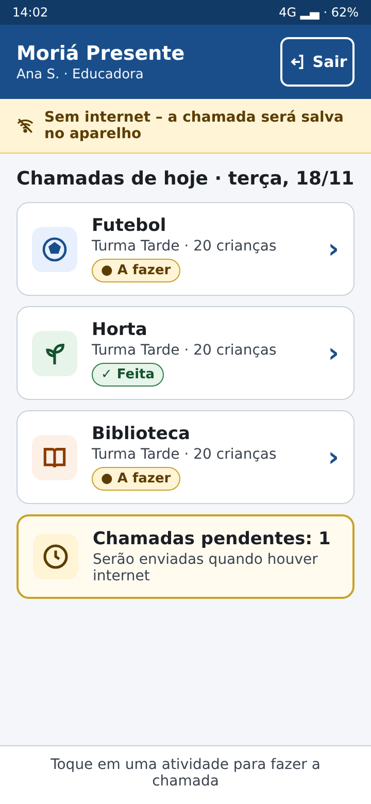
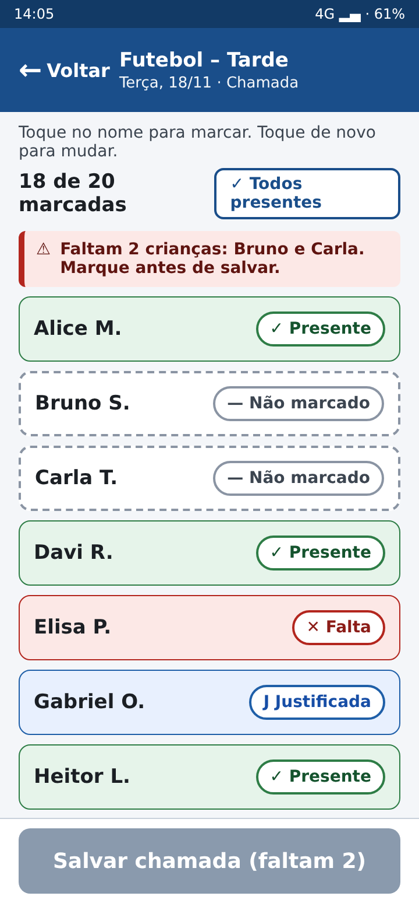
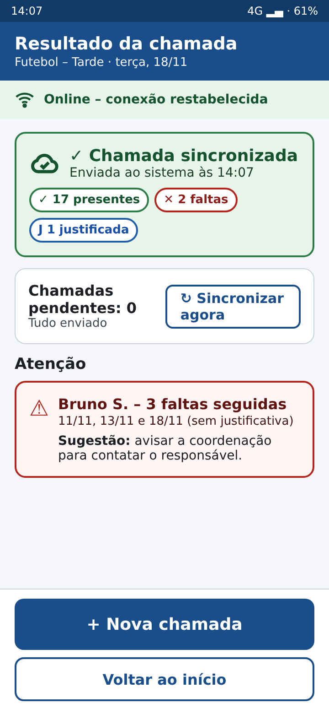

# Moriá Presente

Sistema de cadastro e frequência para a **Associação Instituto Moriá** (bairro Comasa, Joinville/SC), organização que atende cerca de 250 crianças e adolescentes por mês no contraturno escolar.

O MVP substitui as fichas e listas de chamada em papel por uma **PWA offline-first**: educadores e monitores fazem a chamada no celular, mesmo sem internet, e os dados são sincronizados depois com o servidor para gerar relatórios de atendimento.

> Projeto acadêmico: Experiência Prática – Projeto de Software (CST em Análise e Desenvolvimento de Sistemas).

## Problema

- Cadastro e frequência em papel, planilhas soltas e WhatsApp.
- Retrabalho, perda de dados e dificuldade de comprovar o atendimento em editais e para doadores.
- Chamada feita ao ar livre, em celulares simples e com Wi-Fi instável.

## Escopo do MVP

| ID | Requisito | Prioridade |
|----|-----------|------------|
| RF01 | Login por perfil (coordenação / educador) | Obrigatória |
| RF02 | Cadastro de turmas e atividades | Obrigatória |
| RF03 | Cadastro de crianças e responsáveis (com consentimento LGPD) | Obrigatória |
| RF04 | Chamada com um toque, funcionando offline | Obrigatória |
| RF05 | Sincronização automática sem duplicidade | Obrigatória |
| RF06 | Relatório de atendimento por período | Desejável |
| RF07 | Exportação do relatório em PDF/CSV | Desejável |
| RF08 | Alerta de 3 faltas seguidas | Desejável |

Fora do escopo: comunicação automática com os pais, área de acesso das famílias e gestão financeira.

## Arquitetura

Monolito em camadas com cliente PWA offline-first e API REST única.

```
PWA (Angular) ── Dados locais (Service Worker + IndexedDB/Dexie)
        │  HTTPS / JSON
API (Node.js + Express) ── Controllers → Services → Repositories (Prisma)
        │
PostgreSQL (hospedado)
```

## Tecnologias

- **Frontend:** Angular 22, @angular/service-worker (PWA), Angular Material, Dexie.js
- **Backend:** Node.js 26 LTS, Express 5, Zod, Prisma ORM, JWT + bcrypt
- **Banco:** PostgreSQL 18 (hospedado no Supabase)

## Estrutura do repositório

```
moria-presente/
├── frontend/          # PWA Angular (em desenvolvimento)
├── backend/           # API Node.js/Express (em desenvolvimento)
├── docs/
│   ├── modelo-de-dados.md
│   └── prototipo/     # telas do protótipo (dados fictícios)
├── .env.example
└── README.md
```

## Protótipo

| Início | Chamada | Resultado |
|--------|---------|-----------|
|  |  |  |

## Segurança e privacidade

- Senhas armazenadas apenas como hash bcrypt (nunca em texto limpo, MD5 ou SHA-1).
- Consultas parametrizadas via Prisma, validação no servidor com Zod e controles do OWASP Top 10:2025.
- Minimização de dados: não são coletados CPF, RG, foto ou renda das crianças.
- Todos os dados deste repositório são **fictícios**. Segredos ficam em variáveis de ambiente (ver `.env.example`).

## Status

🚧 Em desenvolvimento – fase de especificação e protótipo concluída. Próximo incremento: cadastro e chamada offline.
